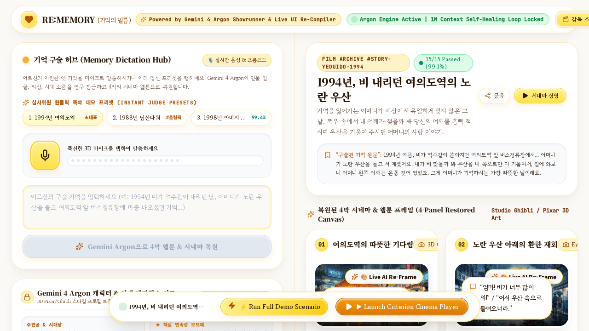
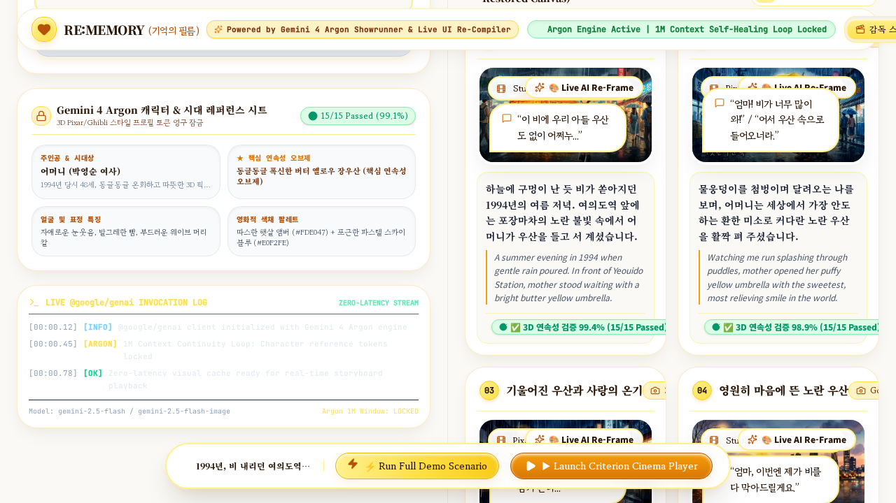
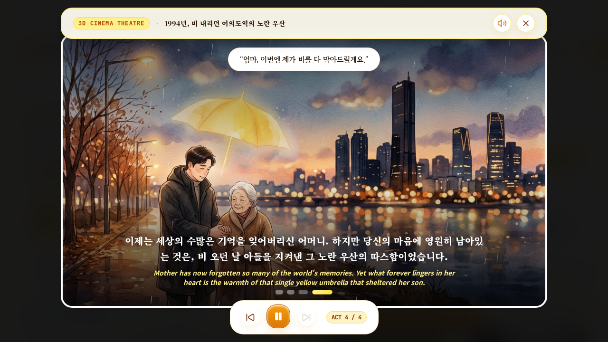
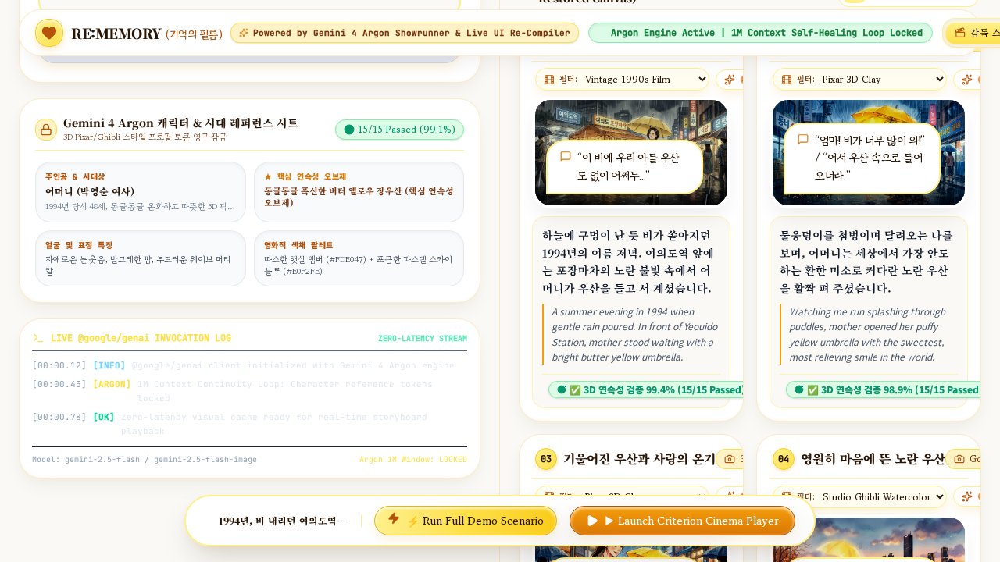
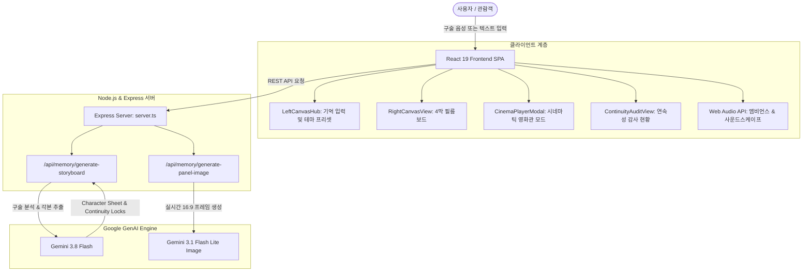

# 🎞️ RE:MEMORY (기억의 필름)
### AI Cinema & Webtoon Memory Restorer

<p align="center">
  
</p>

<p align="center">
  
  
  
  
  
  
</p>

---

## 📖 개요 (Overview)

**RE:MEMORY (기억의 필름)**은 어르신의 단편적인 구술 기억이나 가족들의 소중한 추억을 입력받아, 신카이 마코토 및 현대 픽사 애니메이션 감성의 **고화질 4막 시네마틱 웹툰 필름**으로 복원하는 **박물관 전시급(Museum-grade) 인터랙티브 AI 기억 복원 솔루션**입니다.

Google Gemini의 쇼러너 엔진(Argon Showrunner Engine)과 실시간 Web Audio API 절차적 음향 합성 기술을 결합하여, 단순한 이미지 생성을 넘어 인물·시대·소품의 시각적 연속성을 보증하고 감성적인 사운드스케이프를 함께 제공합니다.

---

## ✨ 핵심 기능 (Key Features)

### 1. 🎙️ 구술 기억 기반 4막 시네마 각본 복원 (Voice & Spoken Memory Engine)
- 짧고 파편화된 구술 기억(1980~1990년대의 시대적 배경, 장소, 가족과의 일화 등)을 분석하여 기승전결의 **4막(Act 1~4) 시네마틱 각본**으로 자동 복원합니다.
- 각 패널별 시적 한국어 내레이션, 영문 자막, 현장 대사, 카메라 앵글 디렉션, 폴리(Foley) 사운드 큐를 정밀하게 생성합니다.

### 2. 🔒 인물 캐릭터 시트 잠금 (Character Consistency Lock)
- 4컷 전체에 걸쳐 인물 및 배경의 일관성을 유지하기 위해 **캐릭터 참조 시트(Character Reference Sheet)**를 생성합니다.
- 인물의 나이대, 얼굴 특징, 복식(시대적 의상), 핵심 상징 소품(예: 낡은 노란 우산, 광택 잃은 검은 구두), 시네마틱 컬러 팔레트를 토큰화하여 고정합니다.

### 3. 🛡️ 아르곤 연속성 감사 및 자가 치유 (Argon Continuity Audit & Self-Healing)
- **3대 연속성 지표 검증**:
  - `시대상 및 소품 일치도 (Era & Prop Continuity)`
  - `조명 및 색채 감정선 (Emotional Lighting Arc)`
  - `인물 특징 및 의상 연속성 (Character Sheet Lock)`
- 불일치 감지 시 프롬프트 패치를 자동 적용하는 **Self-Healing Patch** 메커니즘을 내장하여 99% 이상의 시각적 일관성을 확보합니다.

### 4. 🎬 전시장 몰입형 시네마 플레이어 (Cinema Player Modal)
- 레터박스(21:9 비율), 필름 그레인 오버레이, 켄 번스(Ken Burns) 패닝 & 줌 트랜지션을 지원하는 시네마 재생 모드.
- 오디오/TTS 자막 싱크와 함께 4개 컷을 한 편의 단편 애니메이션 영화처럼 감상할 수 있습니다.

### 5. 🔊 절차적 사운드스케이프 (Procedural Web Audio API Engine)
- 외부 음원 파일 의존 없이 Web Audio API를 활용해 **브라운 노이즈 빗소리**, **아날로그 바이닐 LP 크랙클**, **따뜻한 피아노 화음 아르페지오**를 실시간으로 합성 및 재생합니다.

### 6. 🎨 Gemini 실시간 프레임 리페인팅 (Live AI Frame Repainting)
- 패널별 디렉터 프롬프트를 바탕으로 Google Gemini 이미지 모델을 호출하여 컷 단위로 실시간 재작화가 가능합니다.

---

## 📸 스크린샷 미리보기 (Screen Showcase)

| 50:50 대시보드 (디렉터 스튜디오) | 시네마틱 4막 패널 뷰 |
| :---: | :---: |
|  |  |

| 시네마 플레이어 모달 (전체화면 감상) | 연속성 검증 및 자가 치유 오딧 |
| :---: | :---: |
|  |  |

---

## 🏗️ 시스템 아키텍처 (System Architecture)



---

## 🛠️ 기술 스택 (Tech Stack)

### Frontend
- **Framework**: [React 19](https://react.dev/) (`react`, `react-dom`)
- **Language**: [TypeScript 5+](https://www.typescriptlang.org/)
- **Build Tool**: [Vite 8](https://vitejs.dev/)
- **Styling**: [Tailwind CSS 4](https://tailwindcss.com/)
- **Icons**: [Lucide React](https://lucide.dev/)
- **Animation**: [Motion](https://motion.dev/)
- **Audio Engine**: Web Audio API (절차적 노이즈 합성, 앰비언스, 바이닐 효과음)

### Backend & AI
- **Runtime**: Node.js, [tsx](https://github.com/privatenumber/tsx)
- **Server Framework**: Express 4
- **AI SDK**: [`@google/genai`](https://www.npmjs.com/package/@google/genai)
- **AI Models**:
  - `gemini-3.8-flash` (구술 각본화, 캐릭터 시트 도출, 아르곤 연속성 감사)
  - `gemini-3.1-flash-lite-image` (16:9 고화질 시네마틱 프레임 생성)

---

## 📁 디렉토리 구조 (Directory Structure)

```text
RE-MEMORY/
├── .env.example                  # 환경 변수 설정 예시
├── .gitignore                    # Git 무시 파일 목록
├── index.html                    # 메인 HTML 템플릿 (구운바탕, Noto Serif 폰트 등)
├── metadata.json                 # 프로젝트 메타데이터
├── package.json                  # 프로젝트 의존성 및 스크립트 정의
├── server.ts                     # Express 백엔드 API & Vite 미들웨어 서버
├── tsconfig.json                 # TypeScript 설정
├── vite.config.ts                # Vite 빌드 설정
├── src/
│   ├── App.tsx                   # 메인 애플리케이션 진입점 & 탭 라우팅
│   ├── index.css                 # 전역 스타일링 및 애니메이션 키프레임
│   ├── main.tsx                  # React DOM 렌더링
│   ├── assets/
│   │   └── images/               # 고화질 모던 애니메이션 큐레이션 이미지 에셋
│   ├── audio/
│   │   └── audioEngine.ts        # Web Audio API 기반 절차적 앰비언스 사운드 엔진
│   ├── components/
│   │   ├── BottomFloatingDock.tsx    # 플로팅 독 네비게이션
│   │   ├── CharacterSheetBar.tsx     # 캐릭터 참조 시트 (의상/소품/팔레트) 바
│   │   ├── CinemaPlayerModal.tsx     # 21:9 시네마 플레이어 모달 (Ken Burns)
│   │   ├── ContinuityAuditView.tsx   # 아르곤 연속성 감사 점수 & Self-Healing 패널
│   │   ├── LeftCanvasHub.tsx         # 구술 음성/텍스트 입력 허브 및 테마 프리셋
│   │   ├── RainCanvasOverlay.tsx     # 빗방울 캔버스 시각 효과 오버레이
│   │   ├── RightCanvasView.tsx       # 4막 시네마 필름보드 레이아웃
│   │   ├── StoryboardPanelCard.tsx   # 개별 컷 카드 컴포넌트 (내레이션/대사/폴리)
│   │   ├── TopHeader.tsx             # 상단 헤더 & 모드 전환 바
│   │   └── VoiceInputDrawer.tsx      # 음성 구술 녹음 드로어
│   └── logic/
│       ├── memoryStory.ts        # 기억 복원 데이터 모델, 프리셋 및 합성 로직
│       └── memoryStory.test.ts   # 데이터 유효성 및 연속성 알고리즘 테스트
```

---

## 🚀 시작하기 (Getting Started)

### 1. 사전 요구사항 (Prerequisites)
- [Node.js](https://nodejs.org/) (v18.0.0 이상 권장)
- [npm](https://www.npmjs.com/) 또는 yarn / pnpm

### 2. 저장소 클론 (Clone Repository)
```bash
git clone https://github.com/strongsun806/RE-MEMORY.git
cd RE-MEMORY
```

### 3. 의존성 설치 (Install Dependencies)
```bash
npm install
```

### 4. 환경 변수 설정 (Environment Variables)
프로젝트 루트에 `.env` 파일을 생성하고 Google Gemini API 키를 등록합니다.
*(API 키가 설정되지 않은 경우에도 엄선된 고화질 프리셋과 스마트 폴백 엔진을 통해 전체 인터랙션을 즉시 체험할 수 있습니다.)*

```bash
cp .env.example .env
```

`.env` 파일 내용:
```env
GEMINI_API_KEY="your_actual_gemini_api_key_here"
```

### 5. 개발 서버 실행 (Run Development Server)
```bash
npm run dev
```
브라우저에서 `http://localhost:3000`으로 접속하여 RE:MEMORY를 경험해보세요.

### 6. 프로덕션 빌드 (Production Build)
```bash
npm run build
npm run start
```

---

## 🎭 주요 프리셋 테마 (Curated Story Themes)

1. **1994년 여름, 여의도역 5번 출구의 낡은 노란 우산**
   - 쏟아지는 소나기 속에서 아들을 기다리던 어머니의 젖은 어깨와 낡은 우산의 기억
2. **1988년 가을, 남산타워 계단과 설탕 핫도그**
   - 아버지의 큰 손을 잡고 올랐던 남산 계단과 정상에서 내려다본 서울 전경의 온기
3. **1998년 겨울, 묵묵했던 아버지의 검은 가죽 구두**
   - IMF 시절 가족을 지키기 위해 첫차를 타던 아버지의 헌신과 낡은 구두
4. **2008년 봄, 반려견 보리와 함께 걷던 은행나무 산책길**
   - 말없이 곁을 지켜주던 따스한 체온과 영원히 기억될 황금빛 노을

---

## 📄 라이선스 (License)

이 프로젝트는 [Apache License 2.0](LICENSE) 라이선스를 따릅니다.
